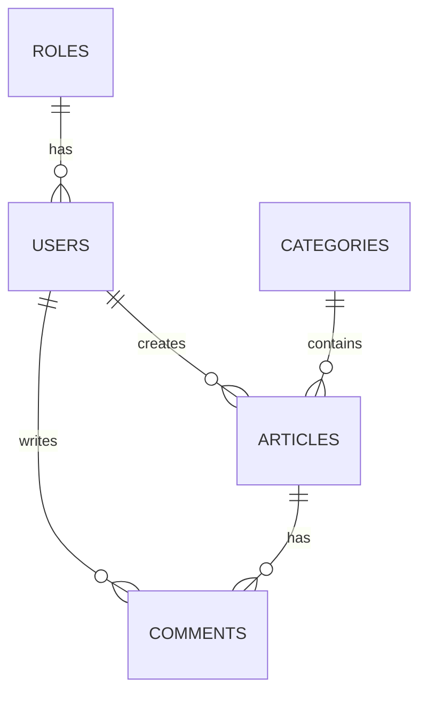

# Логическая модель данных: NewsPortal

## 1. Исходная таблица (Excel отдела новостей)

Предположим, что редакция NewsPortal первоначально ведёт информацию о новостях в одной таблице Excel. Все данные вымышлены.

| ID | Название статьи | Автор | Email автора | Категория | Описание | Дата публикации |
|---|---|---|---|---|---|---|
| 1 | Развитие IT в Таджикистане | Алиев Али | ali@gmail.com | Технологии | Новости IT | 10.11.2026 |
| 2 | Новые технологии образования | Алиев Али | ali@gmail.com | Образование | Новости образования | 11.11.2026 |
| 3 | Развитие экономики | Рахимов Фарход | farhod@gmail.com | Экономика | Новости экономики | 12.11.2026 |
| 4 | Новые достижения науки | Сафаров Рустам | rustam@gmail.com | Наука | Научные новости | 12.11.2026 |

## 2. Анализ исходной таблицы

## 2. Нормализация

### 2.1. Первая нормальная форма (1НФ)

Первая нормальная форма (1НФ) требует, чтобы:

- Каждая ячейка содержала только одно атомарное значение.
- Каждая запись имела уникальный идентификатор.
- Не было повторяющихся групп и списков значений в одной ячейке.

#### Нарушения 1НФ в исходной таблице

1. Поле «Автор» содержит полное имя человека (ФИО), которое можно разделить на отдельные составляющие.
2. Если в поле «Категория» записано несколько категорий через запятую, это нарушает требование атомарности.
3. Если в поле «Автор» записано несколько авторов через запятую, это также нарушает требование атомарности.

#### Исправление нарушений

1. Полное имя автора разделяется на три отдельных поля:
   - last_name — фамилия;
   - first_name — имя;
   - middle_name — отчество.

2. Каждая статья получает уникальный идентификатор.

3. Категории хранятся отдельно в таблице Categories. Для связи статей с несколькими категориями используется отдельная таблица Article_Categories.

#### Таблица Users после приведения к 1НФ

| id | last_name | first_name | middle_name | email |
|---|---|---|---|---|
| 1 | Алиев | Али | NULL | ali@gmail.com |
| 2 | Рахимов | Фарход | NULL | farhod@gmail.com |
| 3 | Сафаров | Рустам | NULL | rustam@gmail.com |

#### Таблица Articles после приведения к 1НФ

| id | title | content | user_id | created_at |
|---|---|---|---|---|
| 1 | Развитие IT в Таджикистане | Новости IT | 1 | 2026-11-10 |
| 2 | Новые технологии образования | Новости образования | 1 | 2026-11-11 |
| 3 | Развитие экономики | Новости экономики | 2 | 2026-11-12 |

#### Таблица Categories

| id | name |
|---|---|
| 1 | Технологии |
| 2 | Образование |
| 3 | Экономика |
| 4 | Наука |

#### Таблица Article_Categories

| article_id | category_id |
|---|---|
| 1 | 1 |
| 2 | 2 |
| 3 | 3 |

### Вывод по 1НФ

В результате приведения данных к первой нормальной форме составные и множественные значения разделены на отдельные поля и записи.

Каждая ячейка содержит одно значение, а каждая запись имеет уникальный идентификатор.

Исходная таблица содержит информацию о разных объектах в одном месте.

Основные проблемы:

1. Данные авторов повторяются в нескольких строках.
2. Email авторов дублируется.
3. Названия категорий повторяются.
4. При изменении информации об авторе необходимо обновлять несколько записей.
5. Данные пользователей, статей и категорий не разделены.

Такая структура затрудняет управление информацией и может приводить к ошибкам.

### 2.2. Вторая нормальная форма (2НФ)

Вторая нормальная форма (2НФ) требует:
- Таблица должна соответствовать первой нормальной форме (1НФ).
- Каждый неключевой атрибут должен полностью зависеть от первичного ключа.
- Не должно быть частичных зависимостей от составного ключа.

#### Проверка 2НФ

В проекте NewsPortal основные таблицы имеют простые первичные ключи `id`.

| Таблица | Первичный ключ | Результат проверки |
|---|---|---|
| Users | id | Соответствует 2НФ |
| Roles | id | Соответствует 2НФ |
| Categories | id | Соответствует 2НФ |
| Articles | id | Соответствует 2НФ |
| Comments | id | Соответствует 2НФ |

Таблица Article_Categories использует составной ключ `(article_id, category_id)` и не содержит дополнительных неключевых атрибутов, поэтому частичных зависимостей в ней нет.

#### Вывод по 2НФ

Все основные таблицы соответствуют второй нормальной форме, поскольку имеют простые первичные ключи, а таблица связей не содержит частично зависимых неключевых атрибутов.

### 2.3. Третья нормальная форма (3НФ)

Третья нормальная форма (3НФ) требует:
- Таблица должна соответствовать 2НФ.
- Не должно быть транзитивных зависимостей неключевых атрибутов от первичного ключа.

#### Поиск транзитивных зависимостей

В исходной структуре данных NewsPortal можно выделить следующие зависимости:

| Транзитивная зависимость | Решение |
|---|---|
| user_id → role_id → role_name | Создана отдельная таблица Roles |
| article_id → category_id → category_name | Создана отдельная таблица Categories |
| article_id → user_id → данные автора | Данные автора вынесены в таблицу Users |

#### Разделение данных для устранения зависимостей

1. Таблица Users хранит информацию о пользователях и содержит внешний ключ role_id.
2. Таблица Roles хранит названия ролей пользователей.
3. Таблица Articles хранит информацию о статьях и ссылки на автора и категорию.
4. Таблица Categories хранит названия и описания категорий.
5. Таблица Comments хранит комментарии и ссылки на пользователей и статьи.

Таким образом, информация о пользователях, ролях и категориях не дублируется в таблице Articles.

#### Проверка 3НФ

Например, если необходимо изменить название категории «Технологии» на «IT и технологии», достаточно изменить одну запись в таблице Categories.

Не требуется изменять все статьи, относящиеся к этой категории.

Аналогично, если изменяется название роли пользователя, достаточно обновить одну запись в таблице Roles.

#### Вывод по 3НФ

В результате устранения транзитивных зависимостей данные разделены на самостоятельные таблицы.

Каждый неключевой атрибут зависит от ключа, всего ключа и ничего кроме ключа.

Логическая модель NewsPortal приведена к третьей нормальной форме (3НФ).

## 3. Выделение основных сущностей

Для построения логической модели выделяем следующие сущности:

| № | Сущность | Назначение |
|---|---|---|
| 1 | Users | Хранение информации о пользователях |
| 2 | Roles | Хранение ролей пользователей |
| 3 | Categories | Хранение категорий новостей |
| 4 | Articles | Хранение новостных статей |
| 5 | Comments | Хранение комментариев |

## 4. Логическая структура таблиц

### 4.1. Users (Пользователи)

| Поле | Тип данных | Назначение |
|---|---|---|
| id | INT | Первичный ключ |
| name | VARCHAR | Имя пользователя |
| email | VARCHAR | Электронная почта |
| password | VARCHAR | Хеш пароля |
| role_id | INT | Идентификатор роли |

### 4.2. Roles (Роли)

| Поле | Тип данных | Назначение |
|---|---|---|
| id | INT | Первичный ключ |
| name | VARCHAR | Название роли |

### 4.3. Categories (Категории)

| Поле | Тип данных | Назначение |
|---|---|---|
| id | INT | Первичный ключ |
| name | VARCHAR | Название категории |
| description | TEXT | Описание категории |

### 4.4. Articles (Статьи)

| Поле | Тип данных | Назначение |
|---|---|---|
| id | INT | Первичный ключ |
| title | VARCHAR | Заголовок статьи |
| content | TEXT | Содержание статьи |
| user_id | INT | Автор статьи |
| category_id | INT | Категория статьи |
| status | VARCHAR | Статус публикации |
| created_at | DATETIME | Дата создания |

### 4.5. Comments (Комментарии)

| Поле | Тип данных | Назначение |
|---|---|---|
| id | INT | Первичный ключ |
| article_id | INT | Идентификатор статьи |
| user_id | INT | Автор комментария |
| content | TEXT | Текст комментария |
| created_at | DATETIME | Дата создания |

## 5. Связи между сущностями

1. Одна роль может принадлежать многим пользователям.
2. Один пользователь может создавать много статей.
3. Одна категория может содержать много статей.
4. Одна статья может иметь много комментариев.
5. Один пользователь может оставлять много комментариев.

## 6. ER-диаграмма

## 7. Вывод

В результате анализа исходной таблицы разработана предварительная логическая модель базы данных NewsPortal.

Данные разделены на пять основных сущностей: Users, Roles, Categories, Articles и Comments.

Такая структура позволяет уменьшить дублирование информации, обеспечить целостность данных и упростить управление новостным порталом.

Примечание: данная модель является предварительной. Перед реализацией необходимо сверить её с фактической структурой базы данных проекта.