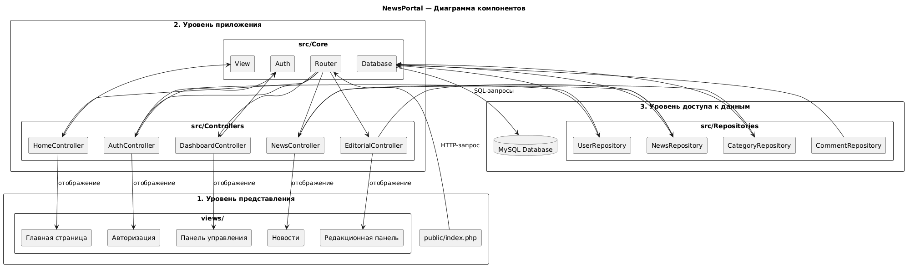

# Техническое задание на разработку информационной системы новостного портала «NewsPortal»

**Версия:** 1.0  
**Дата:** 19.11.2026  
**Разработчик:** `<ФИО>`, группа `<номер группы>`  
**Заказчик:** условная редакция новостного портала NewsPortal

---

## 1. Общие сведения

### 1.1. Полное и краткое наименование

Полное наименование системы: информационная система управления новостным порталом «NewsPortal».

Краткое наименование: NewsPortal.

### 1.2. Основание для разработки

Основанием для разработки является учебный проект по дисциплине, связанной с проектированием и разработкой информационных систем.

Проект предназначен для автоматизации основных процессов работы интернет-редакции: создания новостей, редактирования материалов, публикации, управления категориями, комментариями и пользователями.

### 1.3. Заказчик и исполнитель

Заказчик — условная редакция новостного портала NewsPortal.

Исполнитель — студент `<ФИО>`, группа `<номер группы>`.

### 1.4. Сроки разработки

Разработка выполняется в течение учебного семестра в соответствии с календарным планом курса.

Основные этапы: проектирование, дизайн, разработка интерфейса, программирование серверной части, тестирование и публикация.

---

## 2. Назначение и цели создания системы

### 2.1. Назначение системы

NewsPortal предназначена для публикации, хранения, редактирования и управления новостными материалами через веб-интерфейс.

Система объединяет читателей, журналистов, редакторов и администраторов в едином информационном пространстве.

### 2.2. Основные цели

1. Создать единое хранилище новостных материалов.
2. Автоматизировать процесс подготовки и редакционной проверки новостей.
3. Обеспечить публикацию материалов на русском и таджикском языках.
4. Упростить поиск новостей по заголовкам, категориям и тегам.
5. Обеспечить управление пользователями и разграничение доступа.
6. Организовать хранение комментариев, изображений и уведомлений.

### 2.3. Измеримые показатели достижения целей

| Показатель | Целевое значение |
|---|---|
| Время открытия основных страниц | Не более 3 секунд при штатной нагрузке |
| Время выполнения поиска | Не более 3 секунд на тестовой базе |
| Поддерживаемые языки публикаций | Не менее 2: русский и таджикский |
| Роли пользователей | 4 роли |
| Контроль доступа | 100% защищённых операций проверяют права пользователя |
| Резервное копирование | Не реже одного раза в сутки |
| Проверка обязательных функций | 100% тестов Must должны проходить |

Показатели являются целевыми и подлежат проверке во время испытаний.

---

## 3. Характеристика объекта автоматизации

### 3.1. Объект автоматизации

Объектом автоматизации является работа условной интернет-редакции, которая занимается созданием, проверкой и публикацией новостных материалов.

До внедрения системы сведения о новостях, авторах, категориях и комментариях могут храниться в отдельных документах и таблицах. Это затрудняет поиск информации, контроль редакционного процесса и совместную работу сотрудников.

NewsPortal предназначена для объединения этих операций в одной системе.

### 3.2. Основные участники системы

- **ADMIN (администратор)** — управляет пользователями и основными настройками системы.
- **EDITOR (редактор)** — проверяет материалы, принимает редакционные решения и управляет публикациями.
- **JOURNALIST (журналист)** — создаёт новости, редактирует собственные материалы и отправляет их на проверку.
- **READER (читатель)** — просматривает опубликованные новости и оставляет комментарии.

### 3.3. Основные бизнес-процессы

1. Регистрация и авторизация пользователей.
2. Создание новостного материала журналистом.
3. Выбор категории и добавление тегов.
4. Добавление изображений к новости.
5. Отправка материала на редакционную проверку.
6. Проверка материала редактором.
7. Одобрение, отклонение или отправка материала на доработку.
8. Публикация новости.
9. Просмотр и поиск опубликованных материалов.
10. Добавление и модерация комментариев.
11. Получение уведомлений о действиях с материалами.

### 3.4. Глоссарий

| Термин | Значение |
|---|---|
| Новость | Информационный материал, предназначенный для публикации |
| Журналист | Пользователь, создающий новостные материалы |
| Редактор | Пользователь, проверяющий и одобряющий материалы |
| Категория | Раздел, объединяющий новости по тематике |
| Тег | Ключевое слово для классификации и поиска |
| Перевод | Версия новости на другом языке |
| Модерация | Проверка материалов и комментариев |
| Уведомление | Сообщение пользователю о событии в системе |

### 3.5. Вывод по анализу аналогов

При проектировании NewsPortal учитываются типовые возможности новостных порталов и систем управления содержимым: публикация статей, категоризация, поиск, мультиязычность и редакционная проверка.

Главная особенность NewsPortal — сочетание редакционного процесса и хранения переводов одной новости в отдельных записях базы данных.

---

## 4. Требования к системе

### 4.1. Требования к системе в целом

#### 4.1.1. Архитектура

Система должна иметь клиент-серверную архитектуру и предоставлять доступ через веб-браузер.

Серверная часть разрабатывается на PHP. Для взаимодействия с базой данных используется MySQL-совместимая СУБД и PDO.

Структура проекта разделена на контроллеры, модели, сервисы, конфигурацию, ядро приложения и представления.

#### 4.1.2. Надёжность

- Система должна корректно обрабатывать ошибки подключения к базе данных.
- Данные должны храниться в таблицах с первичными и внешними ключами.
- Резервное копирование базы данных должно выполняться не реже одного раза в сутки.
- При ошибке загрузки изображения система должна сообщать пользователю о проблеме.
- Операции изменения данных должны проверяться на корректность.

#### 4.1.3. Безопасность

- Доступ к закрытым разделам предоставляется только авторизованным пользователям.
- Пароли должны храниться в виде криптографических хешей.
- Доступ к функциям должен проверяться с учётом роли пользователя.
- SQL-запросы с пользовательскими данными должны выполняться с использованием подготовленных выражений.
- Пользовательский ввод должен проверяться и безопасно выводиться в HTML.
- Секретные параметры подключения должны храниться в конфигурации окружения, а не в публичном репозитории.
- Загрузка файлов должна ограничиваться разрешёнными типами и размерами.

#### 4.1.4. Производительность

- Основные страницы должны открываться не более чем за 3 секунды при штатной нагрузке.
- Поиск новостей должен выполняться не более чем за 3 секунды на тестовом наборе данных.
- Список новостей должен поддерживать постраничный вывод.
- Для часто используемых полей должны применяться индексы базы данных.

#### 4.1.5. Требования к персоналу

Для работы с системой необходимы:

- администратор, управляющий учётными записями;
- редактор, проверяющий публикации;
- журналист, создающий новости;
- читатель, просматривающий материалы.

Специальные навыки программирования от пользователей не требуются.

### 4.2. Требования к функциям

#### 4.2.1. Функциональные требования

Приоритеты:
- **Must** — обязательная функция.
- **Should** — важная функция.
- **Could** — дополнительная функция.

| Код | Функциональное требование | Приоритет |
|---|---|---|
| ФТ-01 | Система должна обеспечивать авторизацию пользователей | Must |
| ФТ-02 | Система должна обеспечивать управление учётными записями пользователей | Must |
| ФТ-03 | Система должна обеспечивать управление категориями новостей | Must |
| ФТ-04 | Журналист должен иметь возможность создавать новости | Must |
| ФТ-05 | Журналист должен иметь возможность редактировать собственные материалы | Must |
| ФТ-06 | Система должна обеспечивать отправку новостей на редакционную проверку | Must |
| ФТ-07 | Редактор должен иметь возможность проверять новости | Must |
| ФТ-08 | Редактор должен иметь возможность принимать редакционное решение | Must |
| ФТ-09 | Система должна обеспечивать публикацию одобренных новостей | Must |
| ФТ-10 | Система должна поддерживать русские и таджикские переводы новостей | Must |
| ФТ-11 | Система должна обеспечивать поиск новостей | Should |
| ФТ-12 | Система должна поддерживать категории и теги | Should |
| ФТ-13 | Пользователь должен иметь возможность добавлять комментарии | Should |
| ФТ-14 | Система должна обеспечивать модерацию комментариев | Should |
| ФТ-15 | Система должна поддерживать загрузку изображений к новостям | Should |
| ФТ-16 | Система должна создавать уведомления о важных событиях | Could |
| ФТ-17 | Система должна предоставлять статистику по новостям | Could |

#### 4.2.2. Пользовательские истории

**US-01. Авторизация**

Как пользователь, я хочу войти в систему, чтобы получить доступ к функциям, соответствующим моей роли.

Критерий приёмки: пользователь с правильными учётными данными успешно входит в систему; при неправильных данных появляется сообщение об ошибке.

**US-02. Создание новости**

Как журналист, я хочу создать новость с заголовком, текстом и категорией, чтобы подготовить материал к публикации.

Критерий приёмки: новость сохраняется в базе данных и связана с автором.

**US-03. Редакционная проверка**

Как редактор, я хочу просматривать отправленные новости, чтобы проверять их перед публикацией.

Критерий приёмки: редактор видит материалы, ожидающие проверки.

**US-04. Редакционное решение**

Как редактор, я хочу одобрить материал или отправить его на доработку, чтобы контролировать качество публикаций.

Критерий приёмки: решение сохраняется в журнале редакционных решений.

**US-05. Просмотр новостей**

Как читатель, я хочу просматривать опубликованные новости, чтобы получать актуальную информацию.

Критерий приёмки: читатель видит опубликованные материалы и не получает доступ к черновикам.

**US-06. Поиск новостей**

Как читатель, я хочу искать новости по заголовку, чтобы быстрее находить нужную информацию.

Критерий приёмки: система выводит материалы, соответствующие поисковому запросу.

**US-07. Комментарии**

Как читатель, я хочу оставлять комментарии к новостям, чтобы выражать своё мнение.

Критерий приёмки: комментарий сохраняется и получает статус модерации.

#### 4.2.3. Матрица доступа

Обозначения: «да» — разрешено; «свои» — только собственные материалы; «просмотр» — доступ только для чтения; «—» — доступа нет.

| Функция | ADMIN | EDITOR | JOURNALIST | READER |
|---|---|---|---|---|
| Управление пользователями | да | — | — | — |
| Управление категориями | да | да | просмотр | — |
| Создание новости | — | да | да | — |
| Редактирование новости | — | все материалы | свои | — |
| Отправка новости на проверку | — | да | свои | — |
| Проверка новостей | — | да | — | — |
| Одобрение и отклонение новостей | — | да | — | — |
| Публикация новостей | — | да | — | — |
| Просмотр опубликованных новостей | да | да | да | да |
| Поиск новостей | да | да | да | да |
| Управление тегами | да | да | свои материалы | — |
| Загрузка изображений | да | да | свои материалы | — |
| Добавление комментариев | да | да | да | да |
| Модерация комментариев | да | да | — | — |
| Просмотр уведомлений | свои | свои | свои | свои |

Матрица является проектируемой моделью доступа. Перед реализацией необходимо сверить её с проверками прав в контроллерах и middleware.

### 4.3. Требования к видам обеспечения

**Информационное обеспечение**

База данных `news_portal`. Физическая схема `database/schema.sql` предусматривает 13 таблиц: `roles`, `users`, `categories`, `category_translations`, `articles`, `article_translations`, `tags`, `article_tags`, `media`, `comments`, `editorial_decisions`, `notifications`, `activity_logs`.

Таблицы используют InnoDB, первичные и внешние ключи. Для хранения многоязычных данных применяется кодировка `utf8mb4` и сопоставление `utf8mb4_unicode_ci`.

**Программное обеспечение**

- PHP — серверный язык программирования.
- MySQL или MariaDB — система управления базами данных.
- PDO — взаимодействие с базой данных.
- HTML, CSS и JavaScript — клиентская часть.
- Apache/XAMPP — локальная среда разработки.
- Nginx и PHP-FPM — целевая конфигурация развёртывания, указанная в диаграмме `07-deployment.puml`.

Точные версии компонентов должны быть зафиксированы в документации развёртывания.

**Техническое обеспечение**

Для локальной разработки используется компьютер с Windows и установленной средой XAMPP.

Целевая серверная конфигурация согласно диаграмме развёртывания: Linux VDS, Ubuntu 24.04, Nginx, PHP-FPM 8.2 и MariaDB 10.11.

**Лингвистическое обеспечение**

Интерфейс и основные сообщения системы должны поддерживать русский язык. База данных должна обеспечивать корректное хранение и поиск данных на кириллице. Для новостей предусмотрены русский и таджикский языки.

---

## 5. Модели системы

В данном разделе приводятся графические модели, описывающие поведение, структуру, данные и развёртывание NewsPortal.

### 5.1. Диаграмма вариантов использования

**Рис. 1.** Диаграмма вариантов использования показывает взаимодействие администратора, редактора, журналиста и читателя с основными функциями новостного портала.

### 5.2. Процесс создания и публикации новости

**Рис. 2.** Диаграмма деятельности описывает путь новости от создания журналистом до проверки редактором и публикации.

**Рис. 3.** Диаграмма последовательности показывает взаимодействие пользователя, контроллера, сервиса и базы данных при отправке новости на редакционную проверку.

### 5.3. Структурные модели

**Рис. 4.** Диаграмма классов отражает основные классы приложения и отношения между ними.

**Рис. 5.** Диаграмма компонентов показывает разделение NewsPortal на контроллеры, модели, сервисы, ядро, представления и базу данных.

### 5.4. Модель данных и развёртывание

**Рис. 6.** ER-диаграмма отображает сущности базы данных NewsPortal, их атрибуты и связи.

**Рис. 7.** Диаграмма развёртывания показывает размещение веб-приложения, веб-сервера, PHP-FPM, базы данных и файлов медиа на сервере.

---

## 6. Состав и содержание работ

Разработка выполняется поэтапно в соответствии с планом учебного курса.

| Этап | Работы | Результат | Срок |
|---|---|---|---|
| 1. Проектирование | Анализ предметной области, требования, модели, проектирование БД | Техническое задание, диаграммы, `schema.sql` | День 8 (РК-1) |
| 2. Дизайн | Разработка UX/UI и макетов интерфейса | Макет и прототип | День 9 |
| 3. Frontend | HTML, CSS, JavaScript, адаптивная вёрстка | Статические страницы | Дни 10–11 |
| 4. Backend | PHP, подключение БД, авторизация, функции портала | Работающий MVP | Дни 12–14 |
| 5. Тестирование | Подготовка тест-кейсов и проверка функций | `15-test-cases.md` | День 15 |
| 6. Публикация | Настройка VDS, веб-сервера и HTTPS | Развёрнутый сайт | День 16 (РК-2) |

Точные календарные даты устанавливаются по расписанию учебной группы.

---

## 7. Порядок контроля и приёмки

### 7.1. Виды испытаний

Приёмка NewsPortal проводится путём функционального тестирования, проверки разграничения доступа, проверки базы данных и проверки нефункциональных требований.

### 7.2. Порядок испытаний

1. Проверить подключение к базе данных `news_portal`.
2. Выполнить подготовку структуры базы данных с использованием `database/schema.sql` на отдельной тестовой базе.
3. Добавить демонстрационные данные с помощью `database/seed.sql`.
4. Выполнить контрольные SQL-запросы из `database/queries.sql`.
5. Проверить вход пользователей с различными ролями.
6. Проверить создание и редактирование новостей.
7. Проверить отправку новости на редакционную проверку.
8. Проверить одобрение и отправку материала на доработку.
9. Проверить публикацию и просмотр новостей.
10. Проверить комментарии, категории, теги и загрузку изображений.
11. Проверить ограничения доступа для каждой роли.
12. Проверить скорость основных операций и корректность обработки ошибок.

### 7.3. Критерии приёмки

Система считается принятой, если:

- все обязательные требования Must выполнены;
- все обязательные пользовательские истории проходят проверку;
- отсутствуют критические ошибки;
- пользователи не могут выполнять операции, запрещённые их ролям;
- данные корректно сохраняются и извлекаются из базы;
- контрольные запросы SQL выполняются без ошибок;
- интерфейс корректно отображает русские и таджикские символы;
- основные нефункциональные требования подтверждены испытаниями.

Результаты испытаний фиксируются в документе `15-test-cases.md`.

---

## 8. Требования к документированию

В состав документации проекта входят:

| Документ | Назначение |
|---|---|
| `README.md` | Описание проекта и инструкция по запуску |
| `docs/01-domain-analysis.md` | Анализ предметной области |
| `docs/02-comparison-matrix.md` | Сравнение аналогов |
| `docs/03-short-spec.md` | Краткая спецификация требований |
| `docs/04-behavior/` | Диаграммы поведения |
| `docs/05-structure/` | Диаграммы структуры |
| `docs/06-logical-model.md` | Логическая модель данных |
| `database/schema.sql` | Структура базы данных |
| `database/seed.sql` | Демонстрационные данные |
| `database/queries.sql` | Контрольные SQL-запросы |
| `docs/07-deployment.puml` | Диаграмма развёртывания |
| `docs/08-technical-specification.md` | Настоящее техническое задание |
| `docs/15-test-cases.md` | Тест-кейсы проекта |

Документы должны храниться в репозитории Git. Изменения должны фиксироваться отдельными коммитами.

---

## 9. Источники разработки

1. Материалы лабораторных работ по анализу предметной области, проектированию и разработке информационных систем.
2. Документация PHP: https://www.php.net/docs.php
3. Документация MariaDB: https://mariadb.com/kb/en/documentation/
4. Документация MySQL: https://dev.mysql.com/doc/
5. Документация PlantUML: https://plantuml.com/
6. Документация Git: https://git-scm.com/doc
7. Документация HTML: https://developer.mozilla.org/docs/Web/HTML
8. Документация CSS: https://developer.mozilla.org/docs/Web/CSS
9. Документация JavaScript: https://developer.mozilla.org/docs/Web/JavaScript

---

**Конец технического задания.**